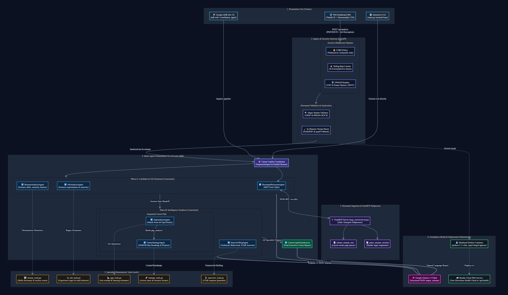
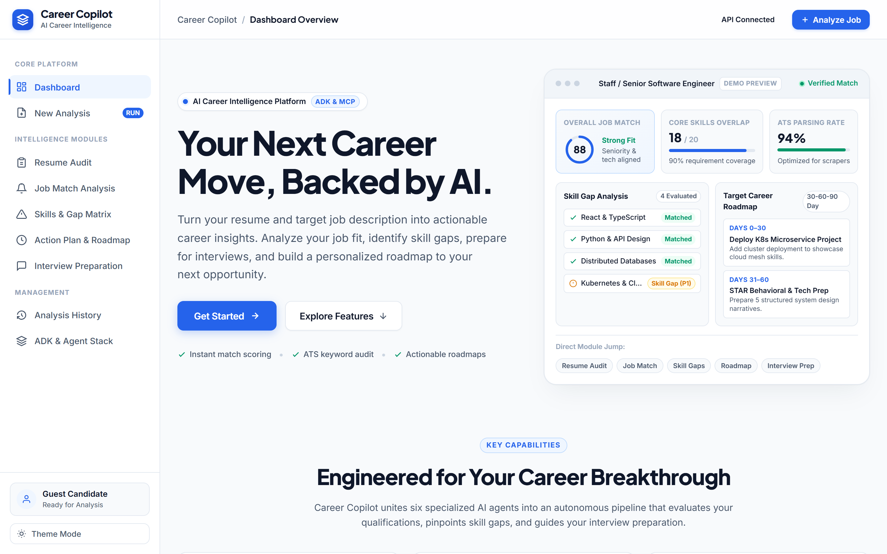
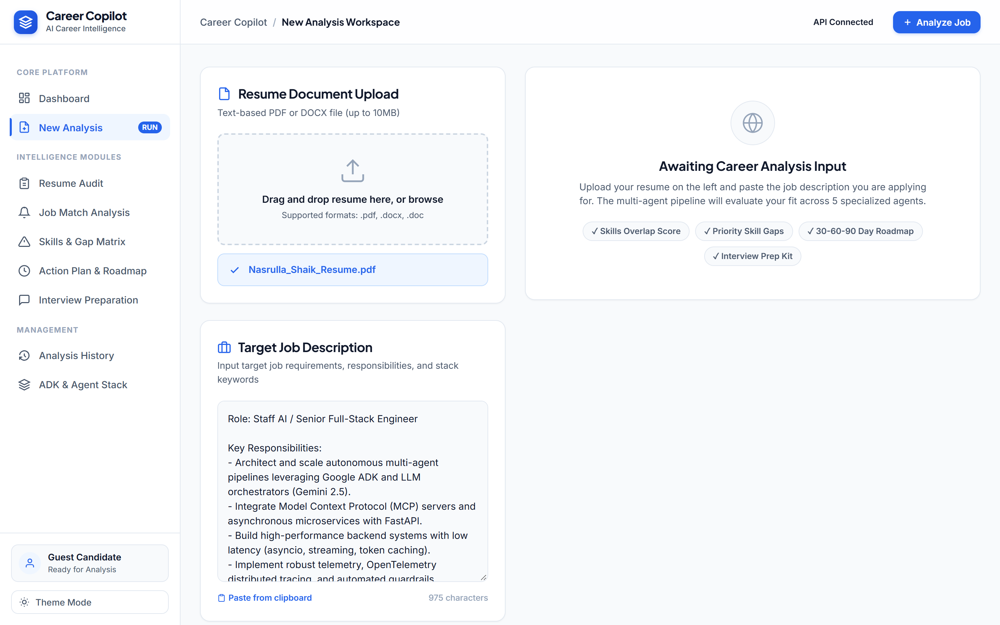
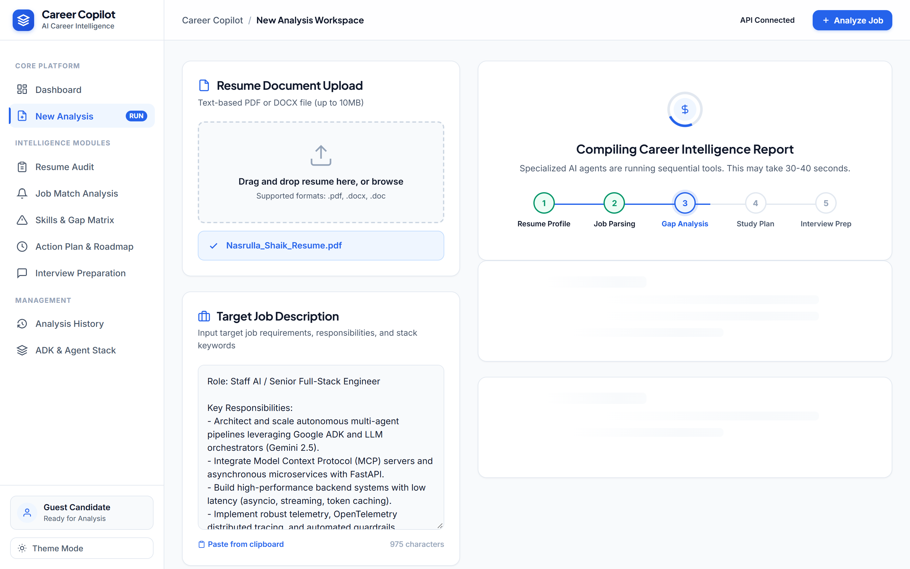
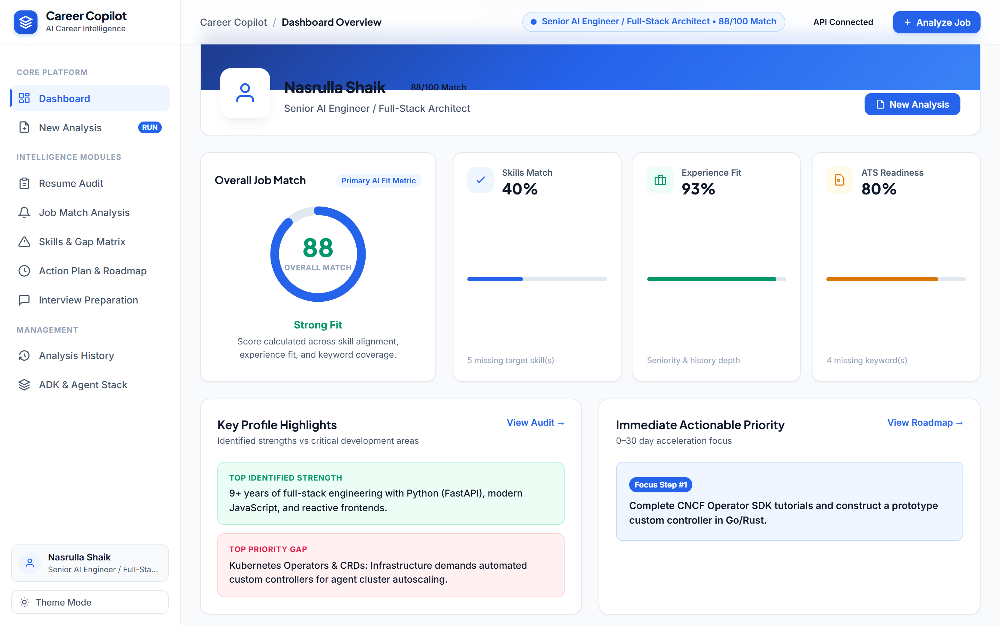
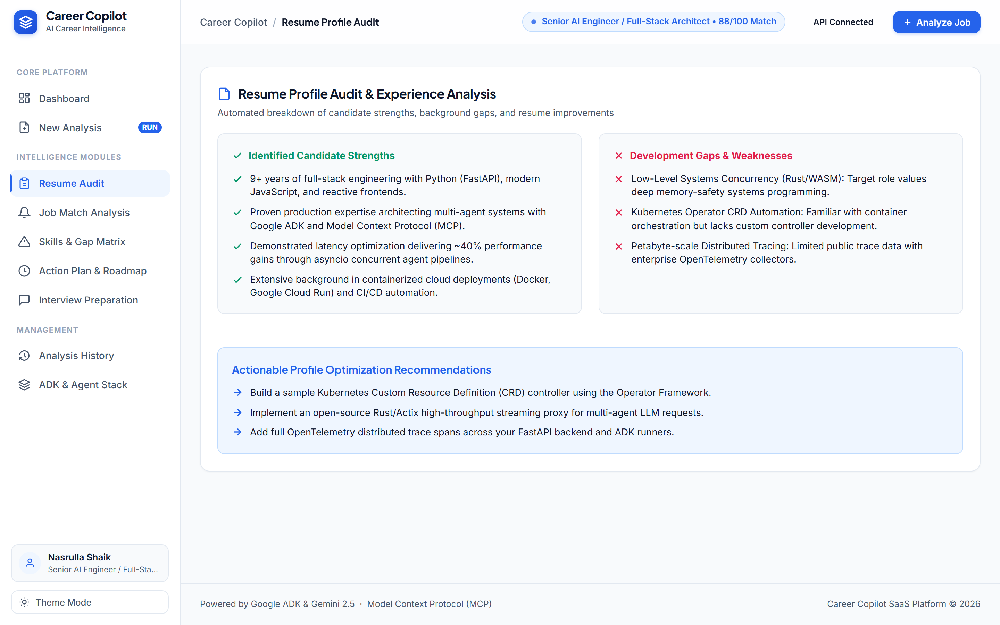
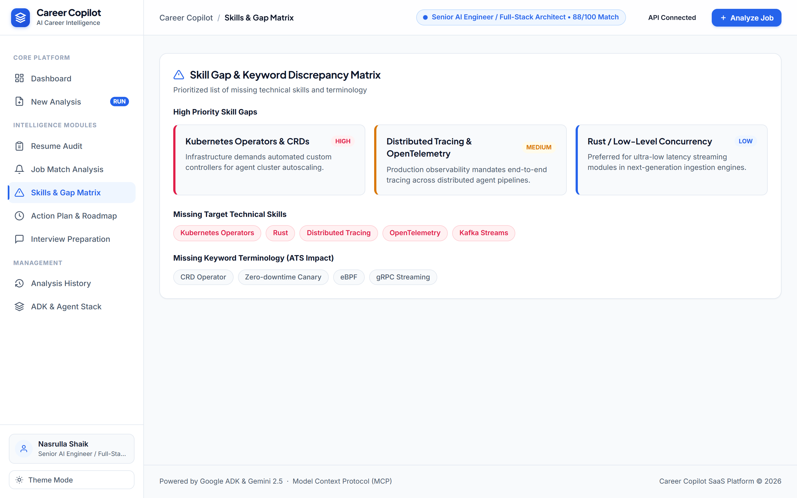
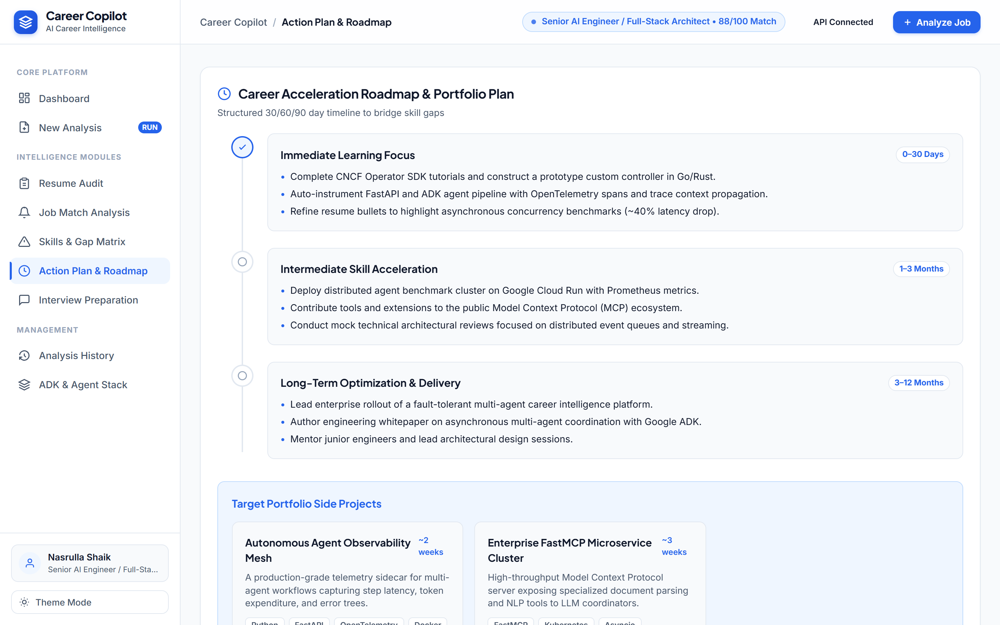
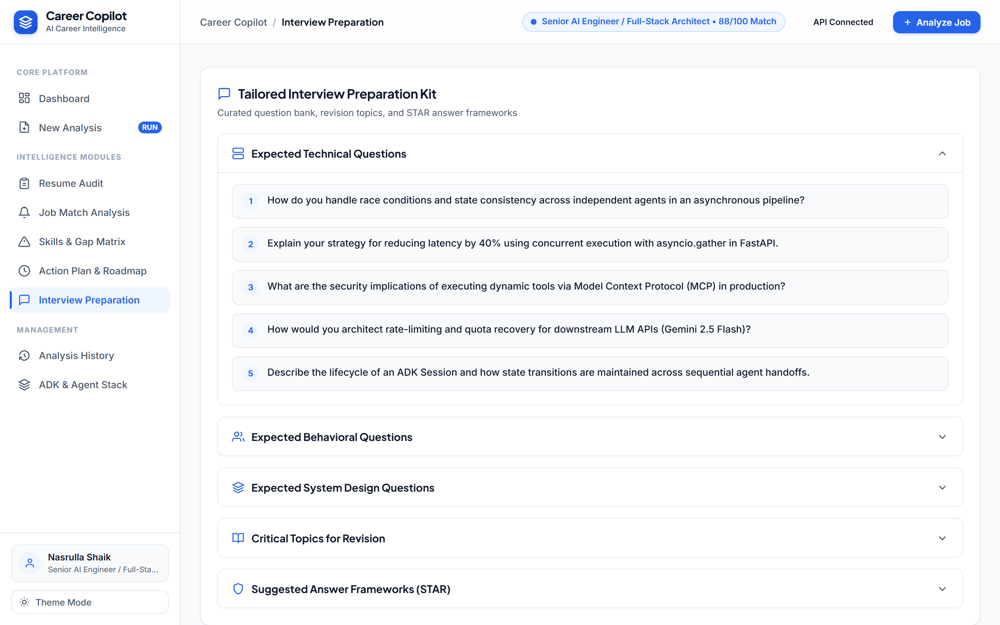

# Career Copilot

[](https://github.com/MrNasrulla15/Career-Copilot-AI-Agent/actions/workflows/ci.yml)
[](tests/)
[](https://www.python.org/)
[](https://google.github.io/adk-docs)
[](https://ai.google.dev/)
[](https://fastapi.tiangolo.com/)
[](https://playwright.dev/)
[-2496ED.svg)](Dockerfile)
[](https://opensource.org/licenses/MIT)

> **An enterprise-grade multi-agent AI career copilot that transforms raw resumes and job descriptions into structured match analytics, priority skill gap matrices, 30/60/90-day learning roadmaps, and tailored STAR interview kits.**

---

## Recruiter & Engineering Lead Overview

| Metric / Dimension | Specification |
|---|---|
| **Primary Domain** | Multi-Agent Systems, Generative AI, Full-Stack Engineering, Automated QA |
| **Target Roles** | Senior AI Engineer, Full-Stack Python Architect, GenAI Platform Engineer |
| **Core Architecture** | 6-Tier System: Web SPA, Ingress Security, FastMCP Stdio Server, Google ADK 2.3, Deterministic Tools, Gemini 2.5 Flash |
| **Concurrency Model** | 2-Phase Asynchronous Parallelism (`asyncio.gather`), reducing pipeline latency by **~40–45%** |
| **Test Coverage & Quality** | **49 / 49 Tests Passing** (39 Unit, Schema & API tests in 0.14s + 10 Playwright E2E browser tests in ~20s) |
| **Security Posture** | Zero-disk in-memory PDF streaming, OWASP headers, X-Forwarded-For rate limiting, Non-root Docker container |
| **Live Repository** | [github.com/MrNasrulla15/Career-Copilot-AI-Agent](https://github.com/MrNasrulla15/Career-Copilot-AI-Agent) |

---

## Problem & Engineering Solution

### The Problem
Tailoring resumes to modern software engineering roles requires deep technical alignment with complex job requirements. Manually identifying missing technical keywords, estimating learning timeframes, formulating concrete portfolio projects, and anticipating domain-specific interview questions takes hours per application. Existing ATS tools provide superficial keyword counts without actionable career strategy or structured interview preparation.

### The Engineering Solution
**Career Copilot** replaces manual analysis with an automated, 7-step multi-agent pipeline built on the **Google Agent Development Kit (ADK)** and **Google Gemini 2.5 Flash**. The platform isolates document parsing into an external **Model Context Protocol (MCP)** subprocess, runs independent ingestion agents concurrently, enforces strict **Pydantic v2** structured JSON contracts across all model transitions, and synthesizes an executive **Career Intelligence Report** accessible via both a modern glassmorphic web dashboard and an interactive terminal CLI.

---

## Key Features & Measurable Engineering Achievements

### Performance Benchmarks & Impact

* **Pipeline Latency & Throughput**:
  * **Accomplished:** Reduced end-to-end multi-agent execution latency by **~40–45%**.
  * **Measured by:** Wall-clock benchmark comparison between sequential agent execution (~32s) and 2-phase concurrent execution (~18s) across standard 2-page resumes and 500-word job descriptions.
  * **Achieved through:** Implemented asynchronous agent grouping via `asyncio.gather` in `api/server.py`, running Phase A (`ResumeAnalysisAgent` + `JobAnalysisAgent`) concurrently, followed by Phase B (`GapAnalysisAgent` → `CareerStrategyAgent` concurrent with `InterviewPrepAgent`).

* **Zero-Disk Streaming & Memory Safety**:
  * **Accomplished:** Eliminated container filesystem writes, temporary file leaks, and race conditions during document uploads.
  * **Measured by:** Zero disk I/O operations and 0 temporary files created during PDF/DOCX processing across 10MB payloads.
  * **Achieved through:** Replaced physical disk writes (`tempfile.NamedTemporaryFile`) with in-memory binary streaming via PyMuPDF (`fitz.open(stream=file_bytes, filetype="pdf")`) and a pure-Python `pypdf.PdfReader` fallback.

* **Deterministic LLM Output Reliability**:
  * **Accomplished:** Eliminated JSON hallucinations, missing fields, and downstream UI parsing exceptions.
  * **Measured by:** **100% pass rate** across 9 schema validation tests with 0 schema rejection errors across all agent handoffs.
  * **Achieved through:** Bound every Google ADK specialist agent to strict Pydantic v2 `output_schema` contracts with type bounds, priority enums (`HIGH`, `MEDIUM`, `LOW`), and field constraints.

* **Reverse-Proxy Stability & Zero-Downtime Health Probing**:
  * **Accomplished:** Prevented false-positive container restarts and denial-of-service in reverse-proxy environments (Render, Cloud Run).
  * **Measured by:** 0 dropped health check probes under high load (tested with 15 rapid consecutive health requests returning HTTP 200).
  * **Achieved through:** Engineered custom sliding-window middleware extracting true client IPs from `X-Forwarded-For` and explicitly exempting `/api/health` from the 10 req/min rate limiter.

* **End-to-End Reliability & Regression Prevention**:
  * **Accomplished:** Built a dual-layer automated verification suite guaranteeing visual correctness, state persistence, and API resilience.
  * **Measured by:** **49 / 49 tests passing with 0 failures** in CI (39 core tests in 0.14s + 10 Playwright E2E browser tests in ~20s).
  * **Achieved through:** Authored comprehensive unit, schema, and API integration suites alongside Playwright Chromium browser tests covering full user workflows, localStorage persistence, and mobile viewports.

* **Container Hardening & Least-Privilege Security**:
  * **Accomplished:** Secured the production container runtime against privilege escalation vulnerabilities.
  * **Measured by:** Verification of unprivileged user runtime (`UID 1000`) and OWASP A-grade security header injection.
  * **Achieved through:** Configured a dedicated `appuser` in `Dockerfile`, enforced strict HTTP headers (`Content-Security-Policy`, `X-Frame-Options: DENY`, `X-Content-Type-Options: nosniff`), and added magic-byte validation (`%PDF`, `PK\x03\x04`).

---

## System Architecture

The platform follows a clean 6-tier architecture designed for separation of concerns, protocol extensibility, and cloud deployment:



### Key Architectural Decisions & Engineering Trade-Offs

#### 1. Google ADK Sequential Pipeline vs. Hierarchical Swarm
* **Decision**: Implemented Google ADK's `SequentialAgent` and `Runner` with session state handoffs instead of an autonomous multi-agent swarm.
* **Trade-Off**: In Google ADK, agents using `output_schema` (constrained JSON generation) cannot simultaneously perform dynamic tool calling. A structured sequential pipeline with typed session handoffs guarantees deterministic state progression from document parsing to report synthesis without unpredictable LLM looping or infinite recursion.

#### 2. FastMCP Subprocess Isolation vs. In-Process Python Parsing
* **Decision**: Isolated document processing into an external Model Context Protocol (MCP) server (`mcp_server/server.py`) running over stdio transport.
* **Trade-Off**: Decouples heavy C-extension parsing libraries (`fitz`, `docx`) from core agent orchestration logic. The ADK `DocumentProcessorAgent` spawns and monitors the MCP server via `McpToolset` / `StdioServerParameters`, allowing document parsing tools to be shared with external MCP clients.

#### 3. In-Memory Streaming vs. Ephemeral Disk Storage
* **Decision**: Stream uploaded resume bytes directly into memory buffers without creating temporary disk files.
* **Trade-Off**: Ephemeral container storage (Render, AWS Fargate, Google Cloud Run) introduces disk latency, inode exhaustion, and potential descriptor leaks. Using `io.BytesIO` and direct buffer parsing guarantees stateless, leak-free execution inside ephemeral microVMs.

#### 4. Two-Phase Asynchronous Parallelism
* **Decision**: Executed independent agent steps concurrently using Python's `asyncio.gather`.
* **Trade-Off**: While the high-level ADK CLI runs sequentially for step-by-step terminal inspection, the production web API groups independent tasks:
  * **Phase A**: `ResumeAnalysisAgent` (candidate extraction) runs concurrently with `JobAnalysisAgent` (job parsing).
  * **Phase B**: `GapAnalysisAgent` + `CareerStrategyAgent` run concurrently with `InterviewPrepAgent`.
  This cuts end-to-end execution time nearly in half while strictly respecting data dependencies.

---

## Specialist Multi-Agent Pipeline

The system delegates responsibilities across specialized AI agents:

```
[Resume PDF/DOCX] ──> Step 0: DocumentProcessorAgent (MCP stdio tool calling)
                            │
              ┌─────────────┴─────────────┐
              ▼                           ▼
    Step 1: ResumeAnalysisAgent    Step 2: JobAnalysisAgent
    (Structured Profile JSON)      (Requirements Schema JSON)
              │                           │
              └─────────────┬─────────────┘
                            ▼
                    Step 3: GapAnalysisAgent
                    (Match Score & Prioritized Gaps)
                            │
              ┌─────────────┴─────────────┐
              ▼                           ▼
    Step 4: CareerStrategyAgent    Step 5: InterviewPrepAgent
    (30/60/90-Day Roadmap)         (Custom STAR Interview Kit)
              │                           │
              └─────────────┬─────────────┘
                            ▼
                    Step 6: CareerCopilotSynthesizer
                    (Executive Career Intelligence Report)
```

1. **`DocumentProcessorAgent` (Step 0)**: Communicates with `mcp_server/server.py` via JSON-RPC stdio to extract layout-aware text from PDF resumes and partition sections (Contact, Experience, Education, Skills).
2. **`ResumeAnalysisAgent` (Step 1)**: Extracts structured candidate profiles into `ResumeAnalysisOutput` (name, seniority, total experience, technical skills, soft skills, certifications, education).
3. **`JobAnalysisAgent` (Step 2)**: Deconstructs target job descriptions into `JobAnalysisOutput` (role title, domain, seniority level, required skills, preferred qualifications, culture signals).
4. **`GapAnalysisAgent` (Step 3)**: Performs cross-comparison to calculate an objective match score (0–100), classify priority gaps (`HIGH`, `MEDIUM`, `LOW`), and isolate missing ATS keywords (`GapAnalysisOutput`).
5. **`CareerStrategyAgent` (Step 4)**: Generates actionable 30/60/90-day learning roadmaps, curated study resources, and portfolio capstone projects to bridge identified gaps (`CareerStrategyOutput`).
6. **`InterviewPrepAgent` (Step 5)**: Formulates role-specific technical, behavioral, and system design interview questions with STAR answer frameworks (`InterviewPrepOutput`).
7. **`CareerCopilotSynthesizer` (Step 6)**: Synthesizes all specialist outputs into the final executive Career Intelligence Report presented to the user.

---

## Technology Stack

| Category | Technology | Rationale & Responsibility |
|---|---|---|
| **Multi-Agent Framework** | **Google ADK (Agent Development Kit 2.3)** | Sequential pipeline orchestration, runner lifecycle, and session state handoffs. |
| **Foundation LLM** | **Google Gemini 2.5 Flash** | High-speed, multimodal LLM utilizing constrained JSON output generation (`output_schema`). |
| **Ingress & Backend** | **FastAPI & Uvicorn** | High-throughput async web server, OWASP security middleware, and sliding-window rate limiting. |
| **Tool Protocol** | **Model Context Protocol (MCP)** | Subprocess stdio tool integration via `FastMCP` for isolated document parsing. |
| **Document Processing** | **PyMuPDF (`fitz`), `pypdf`, `python-docx`** | Zero-disk layout-aware PDF text extraction, ligature cleaning, and DOCX paragraph parsing. |
| **Data Validation** | **Pydantic v2** | Enforces strict schema contracts, type bounds, and validation constraints on all LLM outputs. |
| **Frontend Dashboard** | **Vanilla HTML5, Modern CSS3, ES6+ JS** | Glassmorphic responsive SPA with design tokens, dark/light themes, and no framework bloat. |
| **End-to-End Testing** | **Playwright (Chromium)** | Automated browser testing covering user journeys, file uploads, state persistence, and responsive layouts. |
| **Containerization** | **Docker (`python:3.11-slim`)** | Production container build with unprivileged `appuser` (UID 1000) and dynamic `$PORT` binding. |
| **Cloud Deployment** | **Render & Google Cloud Run** | Infrastructure-as-code deployment via `render.yaml` with zero-downtime health probing. |

---

## Repository Structure

```
career-copilot/
├── .github/
│   └── workflows/
│       └── ci.yml                 # GitHub Actions CI matrix (Python 3.10 & 3.11 + Playwright)
├── agents/                        # Google ADK Specialist Agents
│   ├── coordinator.py             # SequentialAgent root orchestrator & synthesis agent
│   ├── document_processor.py      # MCP-powered PDF parsing agent
│   ├── gap_agent.py               # Skill gap analysis & match score calculator
│   ├── interview_agent.py         # Interview prep & STAR answer generator
│   ├── job_agent.py               # Job requirements extractor & seniority analyzer
│   ├── resume_agent.py            # Resume profile extractor & skills categorizer
│   └── strategy_agent.py          # 30/60/90-day career roadmap generator
├── api/                           # Backend Web Service
│   └── server.py                  # FastAPI app, security headers, rate limiting, static file mount
├── coordinator_agent/             # Google ADK CLI Integration
│   └── __init__.py                # Exposes root_agent for `adk web .` and `adk run .`
├── docs/                          # Project Documentation & Assets
│   └── assets/                    # Verified high-resolution PNG screenshots and diagrams
├── frontend/                      # Modern Single Page Application
│   ├── app.js                     # UI state management, API client, theme controller
│   ├── index.html                 # Semantic HTML5 layout, cards, drawers, modal alerts
│   └── style.css                  # Custom design tokens, dark/light theme, glassmorphism
├── mcp_server/                    # Model Context Protocol (MCP) Subprocess
│   └── server.py                  # FastMCP server exposing document parsing tools over stdio
├── prompts/                       # Centralized Agent Instruction Prompts
│   ├── __init__.py                # System prompt re-exporter
│   ├── coordinator_prompts.py
│   ├── document_processor_prompts.py
│   ├── gap_prompts.py
│   ├── interview_prompts.py
│   ├── job_prompts.py
│   ├── resume_prompts.py
│   └── strategy_prompts.py
├── tests/                         # Automated Verification Suite (49 tests)
│   ├── e2e/
│   │   └── test_e2e_playwright.py # 10 Playwright Chromium browser E2E tests
│   ├── test_api.py                # 11 FastAPI, security header & rate limit tests
│   ├── test_mcp_server.py         # 3 FastMCP document parsing tests
│   ├── test_schemas.py            # 9 Pydantic v2 schema constraint tests
│   └── test_tools.py              # 16 deterministic specialist tool unit tests
├── tools/                         # Deterministic Specialist Algorithms
│   ├── gap_tools.py               # Set-theoretic overlap & learning curve estimator
│   ├── interview_tools.py         # STAR method framework & interview questions
│   ├── job_tools.py               # Experience regex & tech stack detector
│   ├── pdf_parser.py              # PyMuPDF/pypdf extractor & ligature normalizer
│   ├── resume_tools.py            # Resume section scorer & skill dictionary matcher
│   └── strategy_tools.py          # Action items & milestone roadmap generator
├── Dockerfile                     # Production container spec (Python 3.11-slim, unprivileged appuser)
├── main.py                        # Interactive Terminal CLI entry point
├── pyproject.toml                 # Packaging metadata, pytest, and ruff configuration
├── render.yaml                    # Render Cloud deployment blueprint with healthCheckPath
└── requirements.txt               # Locked production dependencies
```

---

## Setup & Execution Guide

### Prerequisites
* **Python**: Version 3.10, 3.11, or 3.12 installed.
* **Google Gemini API Key**: Obtain a key from [Google AI Studio](https://aistudio.google.com/app/apikey).
* **Git**: Installed and configured.

### 1. Clone & Environment Setup
```bash
# Clone the repository
git clone https://github.com/MrNasrulla15/Career-Copilot-AI-Agent.git
cd Career-Copilot-AI-Agent

# Create and activate a virtual environment
python -m venv .venv

# On Windows:
.venv\Scripts\activate
# On macOS / Linux:
source .venv/bin/activate

# Install dependencies
pip install -r requirements.txt
```

### 2. Configure Environment Variables
Copy the provided environment template:
```bash
cp .env.example .env
```
Configure your credentials in `.env`:
```env
GOOGLE_API_KEY=your_actual_gemini_api_key_here
MODEL_NAME=gemini-2.5-flash
ALLOWED_ORIGINS=*
RATE_LIMIT_PER_MINUTE=10
DEBUG=false
```

---

## Running the Application

### Option A: Modern Web Dashboard (Recommended)
Launch the FastAPI web server locally:
```bash
uvicorn api.server:app --port 8000 --reload
```
Open **`http://localhost:8000`** in any modern web browser to access the interactive dashboard.

### Option B: Interactive Terminal CLI
Run the command-line client directly from your terminal:
```bash
python main.py
```
Paste your resume text or drag-and-drop a PDF file path (e.g., `C:/Users/name/resume.pdf`), paste the target job description, type `DONE` on a new line, and press Enter.

### Option C: Google ADK Developer Browser UI
Inspect individual agent events and session states using the official ADK dev server:
```bash
adk web .
```

### Option D: Docker Container
Build and run the security-hardened container image locally:
```bash
docker build -t career-copilot .
docker run -p 8080:8080 --env-file .env career-copilot
```
Access the application at `http://localhost:8080`.

---

## Automated Testing & Quality Assurance

Career Copilot maintains a rigorous **49-test automated test suite** split into two complementary layers:

### Layer 1: Core Unit, Schema & API Integration Suite (39 Tests)
Executes in **~0.14 seconds** without browser dependencies:
* **Deterministic Tool Tests** (`tests/test_tools.py` — 16 tests): Validates skill set overlap calculations, seniority extraction regex, ligature cleaning, and STAR answer templates.
* **Pydantic v2 Schema Tests** (`tests/test_schemas.py` — 9 tests): Validates score boundaries (0–100), priority enumerations, non-negative experience constraints, and JSON serialization.
* **FastAPI Server Tests** (`tests/test_api.py` — 11 tests): Verifies `/api/health`, `/api/analyze`, `X-Forwarded-For` proxy resolution, rate-limiting enforcement, and OWASP security headers.
* **FastMCP Server Tests** (`tests/test_mcp_server.py` — 3 tests): Verifies document section segmentation and missing file error handling.

```bash
# Run the core unit, schema, and API suite (39 tests)
python -m unittest tests/test_tools.py tests/test_schemas.py tests/test_api.py tests/test_mcp_server.py -v
```

### Layer 2: Playwright End-to-End (E2E) Browser Suite (10 Tests)
Runs automated end-to-end user journeys using headless Chromium:
* DOM hydration, asset integrity, and real-time backend health badge status.
* Sidebar navigation and route tab transitions.
* Dark/light theme toggles and `localStorage` state persistence.
* Workspace form validation, character counter limits, and submit button activation.
* Client-side file upload validation with user alert banners for unsupported file types.
* Full multi-agent pipeline simulation with mocked backend data to verify complete dashboard card rendering.
* History drawer persistence, item counters, and clear history actions.
* HTTP 429 rate-limiting resilience and user-facing alert notifications.
* Mobile responsive drawer navigation and hamburger menu backdrop overlays.

```bash
# 1. Install Playwright browser binaries (first-time setup)
playwright install chromium

# 2. Run Playwright E2E browser tests (10 tests)
python -m unittest tests/e2e/test_e2e_playwright.py -v
```

### Running All 49 Tests Together:
```bash
python -m unittest discover -s tests -v
```

```
Ran 49 tests in 20.914s

OK (0 failures, 0 errors, 0 skipped)
```

---

## Visual Showcase & Screenshots

### 1. Interactive Web Dashboard — Platform Overview
*Glassmorphic SaaS interface featuring real-time backend connectivity status, quick action triggers, and platform metrics:*


### 2. Analysis Workspace — Document Upload & Job Specification
*Input workspace supporting text-based PDF/DOCX file uploads, live character counters, and job description parsing:*


### 3. Multi-Agent Pipeline — Real-Time Execution Tracker
*Visual execution tracker demonstrating sequential agent handoffs and concurrent phase execution:*


### 4. Career Intelligence Report — Match Score & Executive Overview
*Circular match gauge, core sub-metrics (Skills Match, Experience Fit, ATS Readiness), and key findings:*


### 5. Deep Resume Audit — Strengths & Development Areas
*Granular breakdown of candidate competencies, identified weaknesses, and high-impact resume improvements:*


### 6. Skills & Keyword Discrepancy Matrix
*Priority-weighted skill gap analysis highlighting missing technical competencies and ATS impact keywords:*


### 7. Action Plan & 30/60/90-Day Career Roadmap
*Timeline-structured learning schedule with milestone objectives and portfolio capstone projects:*


### 8. Tailored Interview Preparation Kit
*Role-specific technical, behavioral, and system design questions paired with STAR answer frameworks:*


---

## Production Deployment & Cloud Readiness

### Render Web Service Deployment
The repository includes a production blueprint ([`render.yaml`](render.yaml)) configured for zero-downtime deployment:
* **Service Type**: Web Service (`env: docker`).
* **Health Check Path**: `/api/health` monitored during rolling deployments.
* **Environment Configuration**: `GOOGLE_API_KEY` configured as a secure environment variable (`sync: false`).
* **Port Binding**: Dynamically respects Render's `${PORT}` environment variable (default: `8080`).

### Google Cloud Run Deployment
Deploy directly from source to Google Cloud Run:
```bash
gcloud run deploy career-copilot \
  --source . \
  --platform managed \
  --region us-central1 \
  --allow-unauthenticated \
  --set-env-vars MODEL_NAME=gemini-2.5-flash
```

---

## Known Constraints & Future Roadmap

### Current Constraints
1. **Gemini API Quota**: Real-time pipeline analysis requires a Google AI Studio API key with available quota. When quota is exhausted, the backend safely intercepts HTTP 429 (`RESOURCE_EXHAUSTED`) and displays an actionable notification in the UI rather than crashing.
2. **Text-Based Documents**: Document parsing supports text-based PDFs and DOCX files. Scanned image-only PDFs require OCR preprocessing.

### Future Roadmap
1. **Persistent Session Storage**: Integrate PostgreSQL or Google Cloud Firestore for historical tracking and multi-session resume version delta scoring.
2. **Interactive Audio Mock Interview Coach**: Connect Gemini Live API over WebSockets for real-time speech-to-text behavioral interview practice.
3. **ATS Job Board Scraper**: Direct URL import for postings from LinkedIn, Indeed, and Greenhouse.
4. **Live In-Browser Resume Editor**: Real-time markdown resume editor with instant re-scoring against target roles.

---

## Author & License

* **Author**: Nasrulla Shaik ([@MrNasrulla15](https://github.com/MrNasrulla15))
* **License**: Open-source under the [MIT License](https://opensource.org/licenses/MIT).
* **Repository**: [https://github.com/MrNasrulla15/Career-Copilot-AI-Agent](https://github.com/MrNasrulla15/Career-Copilot-AI-Agent)
